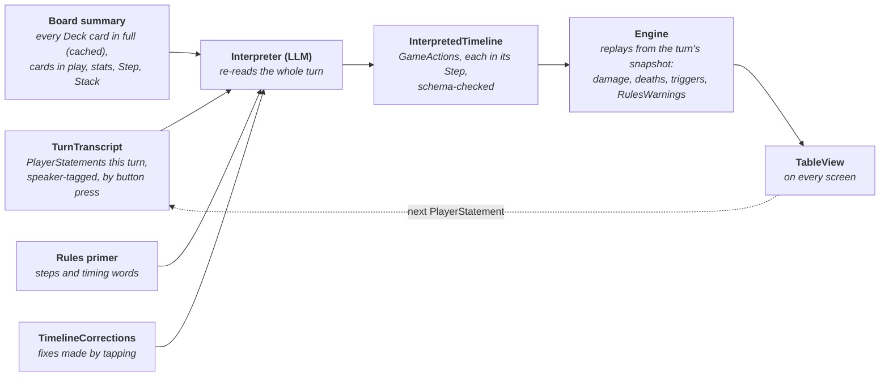
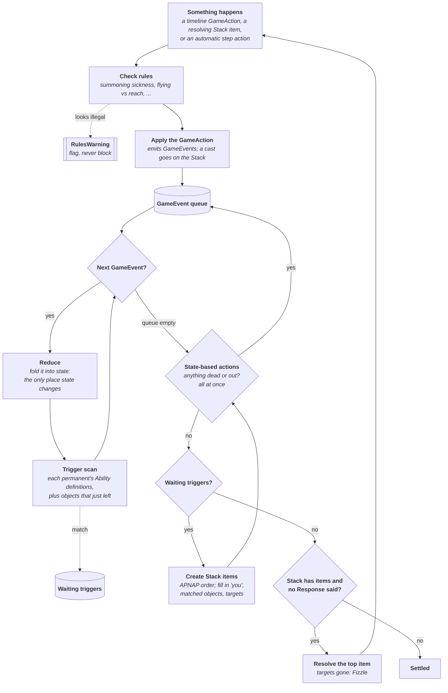
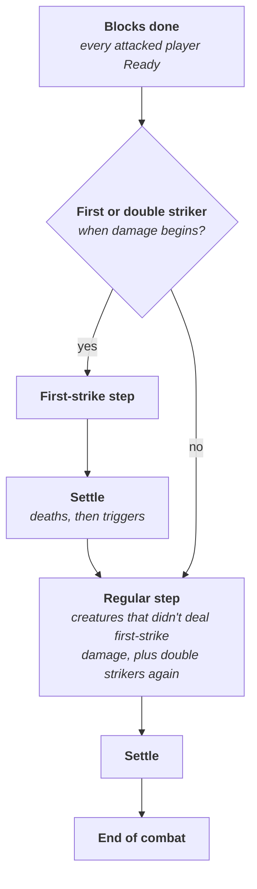

# Engine model

The spec for `packages/engine` and how it connects to the interpreter. It brings together ADRs 0011–0019, [`research/triggers.md`](research/triggers.md) and [`research/rules-digest.md`](research/rules-digest.md). Terms follow [`GLOSSARY.md`](../GLOSSARY.md). Where this doc and an ADR disagree, the ADR wins; fix this doc.

Type shapes here are the target. Once code exists, the code is the source of truth and this doc points to it.

## 1. Domains and the loop

| Domain | Owns | Pure? | Package |
| --- | --- | --- | --- |
| Capture | Hold-to-talk, audio, transcription → PlayerStatement | no | `web`, `server` |
| Interpretation | TurnTranscript, prompt, InterpretedTimeline schema, TimelineCorrections, interpreter evals | prompt building and schema checks are | `interpreter` |
| Rules | game state, GameActions, GameEvents, Stack, Steps, state-based actions, TableView | **yes** | `engine` |
| Table | seats, turns, sealing, the interpretation queue, sending updates | no | `server` (the game's Durable Object) |



The LLM never calculates. It places what was said into Steps, as literal GameActions, referring to cards by name; the interpreter resolves names to IDs by replaying, narrowing copies by what the action needs and asking about anything it can't find (ADR 0038, 0045). What it can't settle it leaves out and returns as a typed PlayerQuestion instead of guessing; the answer is simply the next PlayerStatement (ADR 0043). A stated outcome ("Y survives") is passed through as a claim that the engine checks, with a RulesWarning if it doesn't add up. In-flight handling follows ADR 0017: order by button press, one request in flight, re-send with everything when a response returns, drop stale responses.

Example. After the third statement, the InterpretedTimeline places Shock between the two damage steps. The engine works out that Fencing Ace hits the Wall once, dies, and never gets its second hit.

| Said so far | InterpretedTimeline |
| --- | --- |
| Theo: "Fencing Ace attacks you, it's got double strike." · Melissa: "Okay, Wall of Omens blocks it." · Melissa: "Oh, after its first strike I Shock it." | declareAttackers: Fencing Ace → Melissa · declareBlockers: Wall of Omens blocks Fencing Ace · *first-strike damage (automatic)* · after first strike: Melissa casts Shock → Fencing Ace |
| …then Theo: "Oops, it attacked Michael, not you." | Attack target becomes Michael. The engine flags the Wall's block (only the attacked player can block), and Michael now owes a response. |

## 2. The event loop



- **The board settles between every separate thing:** between two GameActions in one statement, after each resolution, and between first-strike and regular damage. It never settles in the middle of a resolution (CR 704.3, 704.4).
- **Triggers wait for the board to settle.** Stack items are created once state-based actions stop, in APNAP order: the active player's go on first, so they resolve last.
- **The trigger scan looks back.** "Dies" triggers read the state just before the GameEvent, so objects that just left are included (CR 603.10).
- **Stats are calculated whenever they're needed, never stored.** Power and toughness come from base, then "becomes X/Y" effects by timestamp, then counters and modifiers, then switches. Granted keywords count, not just printed ones.
- **Every GameEvent and Stack item records its cause.** Take-backs remove an item and everything downstream of it; the readback can explain why something happened.
- **There's a loop guard.** If one moment produces hundreds of GameEvents, the engine stops and raises a PlayerQuestion asking the table to check the board.

## 3. Steps

| Phase | Step | Automatic | App |
| --- | --- | --- | --- |
| Beginning | Untap | active player's permanents untap; no one acts | reminder |
| | Upkeep | upkeep triggers | triggers |
| | Draw | the active player draws (hands aren't tracked) | reminder: "Draw a card" (ADR 0028) |
| Main 1 | | | |
| Combat | Beginning of combat | triggers | prompt: Declare attackers |
| | Declare attackers | attackers tap unless vigilance; one `AttackersDeclared` batch | ends on "that's it" or a defender's response |
| | Declare blockers | one `BlockersDeclared` batch | each attacked player blocks or takes it → Ready; reminder on a menace attacker with one blocker (ADR 0027) |
| | First-strike damage | exists only if a first or double striker is in combat when damage begins | runs on its own |
| | Combat damage | everyone else, plus double strikers again | runs on its own |
| | End of combat | attacking and blocking end | |
| Main 2 | | | |
| End | End step | end-step triggers (conditions such as "if you gained life this turn" are checked on trigger and on resolution) | triggers |
| | Cleanup | damage wears off, "until end of turn" effects end and borrowed permanents go back, at the same moment; `CleanedUp` lists each (ADR 0021) | next turn |

## 4. The Stack and the timeline

- **Casting isn't resolving.** `SpellCast` fires when a spell is cast; a permanent only enters, with `ZoneChanged`, when it resolves.
- **Resolution is immediate unless someone responds.** A spell resolves at once unless a Response is said. The interpreter places Responses and late statements in the turn's step-indexed timeline, and the engine replays from the turn snapshot.
- **Triggers keep their source's information.** A trigger keeps last-known information about its source, so it resolves even if the source left. A spell or ability whose targets are all gone Fizzles.
- **Replays never silently drop anything.** Items that become illegal after a replay turn into RulesWarnings.

## 5. Combat damage



For each attacker:
- **Unblocked:** its damage goes to what it attacked. If it's a commander, that's also commander damage.
- **Blocked:** damage is divided among its blockers however its controller says. The engine shows a default (lethal to each blocker in turn, the rest to the last one) and accepts a stated division or a stated outcome (ADR 0012).
- **Blockers all gone:** it deals no damage, unless it has trample.
- **Trample:** every blocker must get lethal damage before any goes through.
- **Lifelink:** its controller gains that much life.

## 6. GameEvents and state-based actions

Every board change is a GameEvent, a Magic rules happening; the app's own records (PlayerTasks, PlayerQuestions, RulesWarnings, corrections said) are TableEvents, which never change the board and which triggers never see (ADR 0020). How often cards listen to a GameEvent is documentation, not a type distinction. These 9 GameEvents cover about 89% of trigger clauses on Commander-legal cards. The smaller ones arrive with M3.

| GameEvent | Carries | Serves |
| --- | --- | --- |
| `PhaseStarted` | step, active player, turn | upkeep, end step, combat steps |
| `AttackersDeclared` | attacker → target pairs, one batch | "attacks", "attacks you" |
| `BlockersDeclared` | blocker → attacker pairs, one batch | "blocks", "becomes blocked" |
| `DamageDealt` | source, recipient, amount, combat flag, one batch per step | combat and other damage, commander damage; "deals combat damage to a player" (once per source and player per batch) |
| `LifeChanged` | player, delta, cause | gain, loss, payment |
| `SpellCast` | caster, card, targets, from where | "whenever you cast" |
| `ZoneChanged` | from, to, why (Arena's categories: `castSpell`, `resolve`, `playLand`, `destroy`, `sacrifice`, `exile`, … ADR 0036), and every object that moved at that moment (each with its card and owner); simultaneous moves are one event (ADR 0026) | enters, dies, leaves, exiled, landfall |
| `CountersChanged` | object or player, kind, delta | +1/+1, poison, loyalty |
| `PlayerLost` | player, reason | what they own leaves; what they stole is exiled |

State-based actions for M1:
- A creature with toughness 0 or less dies.
- A creature dies if it has lethal damage, or any damage from a deathtouch source, unless it's indestructible.
- A player loses at 0 life or less, 10 poison, or 21 combat damage from one commander.

## 7. Cards and Ability definitions

The card catalog is built from the game's Deck versions (ADR 0119), loaded when the game wakes and never stored in saved turns; each Scryfall card becomes a `CardDefinition` as ADR 0120 describes, with Oracle text kept beside the catalog rather than in it. Each card's `abilities` is its Translation (M3; empty in M1, where players say the effects). The trigger scan reads these as data; the engine has no card-specific code.

```js
"Authority of the Consuls": { cost: "{W}", types: ["Enchantment"],
  abilities: [
    { id: "authority-of-the-consuls#1", kind: "static",
      effect: { entersTapped: { types: ["Creature"], controller: "opponent" } } },
    { id: "authority-of-the-consuls#2", kind: "triggered",
      when:   { event: "ZoneChanged", to: "battlefield", object: { types: ["Creature"], controller: "opponent" } },
      effect: [{ gameAction: "life", who: "you", delta: +1 }] } ] },

"Haliya, Guided by Light": { cost: "{2}{W}", types: ["Creature"], legendary: true, power: 3, toughness: 3,
  abilities: [
    { id: "haliya-guided-by-light#1", kind: "triggered",
      when:   { event: "ZoneChanged", to: "battlefield", object: { selfOr: { types: ["Creature", "Artifact"], controller: "you" } } },
      effect: [{ gameAction: "life", who: "you", delta: +1 }] },
    { id: "haliya-guided-by-light#2", kind: "triggered",
      when:   { event: "PhaseStarted", step: "end", whose: "you" },
      if:     { lifeGainedThisTurn: { who: "you", atLeast: 3 } },
      effect: [{ playerTask: "Draw a card", who: "you" }] },
    { id: "haliya-guided-by-light#3", kind: "castOption", name: "Warp", cost: "{W}", from: "hand",
      then: { delayedTrigger: { when: "beginning of the next end step",
              effect: [{ gameAction: "move", object: "self", to: "exile", note: "may cast later" }] } } } ] },

"Case of the Uneaten Feast": { cost: "{W}", types: ["Enchantment"],
  abilities: [
    { id: "case-of-the-uneaten-feast#1", kind: "triggered",
      when:   { event: "ZoneChanged", to: "battlefield", object: { types: ["Creature"], controller: "you" } },
      effect: [{ gameAction: "life", who: "you", delta: +1 }] },
    { id: "case-of-the-uneaten-feast#2", kind: "unmodeled", text: "To solve — ... Solved — ..." } ] },

"Coastal Piracy": { cost: "{2}{U}{U}", types: ["Enchantment"],
  abilities: [
    { id: "coastal-piracy#1", kind: "triggered",
      when:   { event: "DamageDealt", combat: true, player: "opponent", object: { types: ["Creature"], controller: "you" } },
      effect: [{ playerTask: "You may draw a card", who: "you" }] } ] }
```

A `DamageDealt` trigger matches only damage to a player: `object` filters the source, `player` is who was dealt damage relative to the ability's controller, and `combat` keeps it to combat damage. The damaged player is the trigger's `defendingPlayer`, so "that player" templates name them. Each damage step is its own batch, so double strike that connects twice triggers twice.

The kinds are:
- `triggered` (with `when` and an optional `if`)
- `static`
- `castOption` (warp and similar)
- `spell` (instants and sorceries)
- `mana` (not tracked)
- `unmodeled`, which becomes a "check this card" PlayerTask

Effects are either a `gameAction` or a `playerTask`, the latter for anything that touches a hand or library.

## 8. Data structures

The engine's types live in `packages/engine/src` (`state.ts`, `actions.ts`, `events.ts`, `cards.ts`, `timeline.ts`) and are the source of truth. The sketch below shows the shape; where it differs from the code, the code wins.

```ts
// The game's Durable Object.
interface Game {
  id: GameId;
  seats: { playerId: PlayerId; name: string; deckId?: DeckId }[];
  deckVersions: Record<PlayerId, DeckVersionId>;   // ADR 0119; the catalog, section 7, is loaded from these
  turnStart: GameState;                      // snapshot the engine replays from
  currentStep: Step;                         // replayed to, ADR 0074
  turnTranscript: PlayerStatement[];
  interpretedTimeline: { readsUpTo: PlayerStatementId; entries: TimelineEntry[] };
  pinned: { entry: TimelineEntry; afterStatements: number }[];  // taps, placed by when they were tapped, ADR 0065
  timelineCorrections: TimelineCorrection[];
  interpreterQueue: { inFlight: PlayerStatementId | null; latestStatement: PlayerStatementId; latestApplied: PlayerStatementId };
  sealedTurns: SealedTurn[];
  ended: { at: string; turn: number; by: PlayerId | null } | null;   // ADR 0101; null by = the shared screen
}

interface PlayerStatement { id: PlayerStatementId; playerId: PlayerId; pressedAt: string; text: string; answering?: string }
interface TimelineEntry { step: Step; playerId: PlayerId; gameAction: GameAction; from: PlayerStatementId[] }

interface GameState {
  turn: { number: number; round: number; activePlayerId: PlayerId; step: Step };
  players: Record<PlayerId, { name: string; life: number; poison: number;
                              commanderDamage: Record<CardName, number>; out: boolean }>;
  permanents: Record<PermanentId, Permanent>;   // flat, so control changes are one field
  graveyards: Record<PlayerId, CardName[]>;
  exile: { card: CardName; ownerId: PlayerId; note?: string }[];
  commandZone: Record<PlayerId, { card: CardName; casts: number }>;   // casts → commander tax
  stack: StackItem[];                            // top is last
  combat: { attacks: { attackerId: PermanentId; target: PlayerId }[];
            blocks: { blockerId: PermanentId; attackerId: PermanentId }[];
            ready: PlayerId[] } | null;
  delayedTriggers: { source: CardName; from: string; when: string; gameActions: GameAction[] }[];
  gameEventsThisTurn: GameEvent[];              // "this turn" conditions read these
}

interface Permanent {
  id: PermanentId; card: CardName; ownerId: PlayerId; controllerId: PlayerId;
  tapped: boolean;
  controlledSince: number;                       // turn number; summoning sickness
  damage: number;
  counters: Record<string, number>;
  effects: { kind: 'set' | 'add' | 'switch'; power?: number; toughness?: number;
             keywords?: string[]; until: 'endOfTurn' | 'removed'; timestamp: number }[];
}

interface StackItem {
  id: StackItemId; kind: 'spell' | 'trigger' | 'ability';
  ability: AbilityId;                            // which Ability definition
  controllerId: PlayerId;
  source: { permanentId?: PermanentId; card: CardName; lastKnown?: Partial<Permanent> };
  triggeredBy?: GameEventId;
  matched?: Record<string, string>;              // what made the trigger match
  targets?: PermanentId[];
  gameActions: GameAction[];                     // filled in when created
  status: 'pending' | 'resolved' | 'countered' | 'fizzled';
}

interface GameEvent {
  id: GameEventId; type: GameEventType;          // section 6, with type-specific fields
  causedBy: Cause;
}
type Cause =
  | { playerStatement: PlayerStatementId }       // M1 causes for most player-stated effects
  | { gameEvent: GameEventId }                   // e.g. damage → life change
  | { stackItem: StackItemId; gameAction: number; triggeredBy?: GameEventId }
  | { rule: string };                            // turn structure, combat damage, state-based

type GameAction =                                // literal only (ADR 0013)
  | { type: 'cast' | 'playLand'; card: CardName; targets?: PermanentId[] }
  | { type: 'move'; objectId: PermanentId; to: Zone; how?: 'destroy' | 'sacrifice' | 'exile' }
  | { type: 'tap' | 'untap'; permanentId: PermanentId }
  | { type: 'gainControl'; permanentId: PermanentId; until?: 'endOfTurn' }
  | { type: 'counters'; objectId: string; kind: string; delta: number }
  | { type: 'modify'; permanentId: PermanentId; power: number; toughness: number; keywords?: string[]; until: 'endOfTurn' }
  | { type: 'createToken'; token: string; count: number }
  | { type: 'life'; playerId: PlayerId; delta: number }
  | { type: 'damage'; sourceId: string; recipient: { playerId: PlayerId } | { permanentId: PermanentId }; amount: number }
  | { type: 'attack'; pairs: { attackerId: PermanentId; target: PlayerId }[] }
  | { type: 'block'; pairs: { blockerId: PermanentId; attackerId: PermanentId }[] }
  | { type: 'noBlock' } | { type: 'doneAttacking' }
  | { type: 'divideDamage'; attackerId: PermanentId; split: Record<PermanentId | PlayerId, number> }
  | { type: 'playerTask'; playerId: PlayerId; text: string };

interface SealedTurn {
  turn: number; activePlayerId: PlayerId;
  finalBoard: GameState;
  turnTranscript: PlayerStatement[]; interpretedTimeline: TimelineEntry[];
  gameEvents: GameEvent[];                       // ADR 0019
  summary: Record<PlayerId, { lifeChange: number }>;   // grows as "last turn" cards need it
}
```

## 9. Engine functions

Interpretation produces the whole turn's timeline every time (ADR 0015, 0016), so the engine's API is small and pure:

| Function | Contract |
| --- | --- |
| `replayTurn(turnStart, timeline, { currentStep })` | Walks the Steps from the snapshot: each Step's automatic actions, then its timeline entries, settling after each (the Stack waits when the next entry is a Response). Returns the `GameState`, the turn's `GameEvent[]`, its TableEvents (numbered `t1`, `t2`… in replay order; never stored in `GameState`) and RulesWarnings, each tagged with the timeline entry that raised it (ADR 0122). The turn's "Do it anyway" overrides and done PlayerTasks are passed in; matching warnings come back marked overridden and matching tasks done (ADR 0123, 0125). Deterministic: same inputs, same output, IDs included. The card catalog lives in the state. |
| `readbackNotes(events)` | Groups a turn's GameEvents into readback notes: one per combat damage step and one per resolved Stack item, each with its cause, the timeline entry it follows from (found by following causes back) and its effects, but no text. Effects a PlayerStatement or BoardCorrection made directly, and turn structure, get none (ADR 0134, 0135). Works the same on a Sealed turn's stored GameEvents. |
| `stepsAhead(state)` | The Steps still to come this turn given the board now, leaving out the ones the rules skip (no attackers: no blockers or combat damage; no first strikers: no first-strike damage). Next step moves to the first; after the last, the turn ends (ADR 0074). |
| `tableView(result)` | What screens show: board with stats, Stack, zones, who still owes a combat response, the combat preview once everyone is Ready, PlayerTasks, reminders (the draw, menace short of blockers; computed, never stored), RulesWarnings and the Steps still to come (`stepsAhead`). |
| `sealTurn(turnStart, timeline, { through? })` | Replays through cleanup (or through the given Step, when the game is ended: ADR 0100), then returns the `SealedTurn` (with GameEvents and summary) and the next turn's `turnStart`, passing to the next player still in the game. |
| `applyBoardCorrection(state, correction, playerId)` | Applies a correction ("Heliod has two counters"), caused by `{ rule: 'boardCorrection' }`, then settles, and records it as a pair: a `BoardCorrectionMade` TableEvent plus the GameEvents it produced (ADR 0020, 0034). Corrections never trigger abilities. |
| `stats(permanent, state)` | Current power, toughness and keywords, calculated whenever asked. |

IDs for new permanents, GameEvents and Stack items are derived from the replay position, never random, so a replay always produces the same IDs.

## 10. Property tests

- `replayTurn` is deterministic: same inputs always give an identical result, IDs included.
- Replaying a prefix of a timeline and then the rest gives the same result as replaying the whole timeline.
- Damage marked on a permanent and life deltas are never NaN, and marked damage is never negative.
- After every settle, no creature has lethal damage or toughness 0 or less, unless it's indestructible (for damage only).
- Every GameEvent's cause points to something that exists: a PlayerStatement, an earlier GameEvent, a Stack item or a rule.
- Combat damage to blockers plus damage to players never exceeds the attackers' total power (doubled for double strikers).
- APNAP: when several players' triggers wait at once, the active player's Stack items sit lowest.

## 11. Worked example

The interactive version, with the board, TurnTranscript, InterpretedTimeline and GameEvents at every step, is the engine page artifact. Here's the condensed form.

**The table:**

| Player | Commander |
| --- | --- |
| Theo | Teysa Karlov |
| Michael | Krenko, Mob Boss |
| Melissa | Amalia Benavides Aguirre |
| Elena | Sythis, Harvest's Hand |

**The game:**

| Turn | What happened | Life after (T / Mi / Me / E) |
| --- | --- | --- |
| R1 Theo | Caves of Koilos, tapped for white (1 damage); Hinterland Sanctifier | 39 / 40 / 40 / 40 |
| R1 Michael | Mountain; Raging Goblin (haste) attacks Theo, unblocked | 38 / 40 / 40 / 40 |
| R1 Melissa | Starting Town | 38 / 40 / 40 / 40 |
| R1 Elena | Plains; Case of the Uneaten Feast | 38 / 40 / 40 / 40 |
| R2 Theo | Plains; Haliya cast for warp. Two triggers (Haliya, Sanctifier) gain 2. Sanctifier hits Michael. End step: Haliya's draw check fails (gained 2, needs 3); warp exiles her | 40 / 39 / 40 / 40 |
| R2 Michael | Mountain; Goblin Guide. Both goblins attack Theo. Goblin Guide's trigger goes on the Stack; Theo responds: Caves for black (1 damage), Fatal Push on top. Push resolves (Goblin Guide dies), then the trigger resolves from last-known information (reveal → PlayerTask). Raging Goblin unblocked | 38 / 39 / 40 / 40 |
| R2 Melissa | Scoured Barrens (enters tapped, +1); Starting Town for white (pays 1); Authority of the Consuls | 38 / 39 / 40 / 40 |
| R2 Elena | Plains; Savannah Lions enters tapped (Authority). Case (Elena) and Authority (Melissa) trigger; APNAP puts Melissa's on top, so it resolves first | 38 / 39 / 41 / 41 |
| R3 Theo (now) | Plains; Disenchant destroys Authority of the Consuls. Hinterland Sanctifier attacks Melissa, who has no blockers | 38 / 39 / 41 / 41 |

**The Stack during Elena's R2** (top is last):

```json
[
  { "id": "k3", "kind": "trigger", "ability": "case-of-the-uneaten-feast#1", "controllerId": "elena",
    "source": { "permanentId": "p7", "card": "Case of the Uneaten Feast" },
    "triggeredBy": "e47", "matched": { "object": "p15" },
    "gameActions": [{ "type": "life", "playerId": "elena", "delta": 1 }], "status": "pending" },
  { "id": "k4", "kind": "trigger", "ability": "authority-of-the-consuls#2", "controllerId": "melissa",
    "source": { "permanentId": "p13", "card": "Authority of the Consuls" },
    "triggeredBy": "e47", "matched": { "object": "p15" },
    "gameActions": [{ "type": "life", "playerId": "melissa", "delta": 1 }], "status": "pending" }
]
```

**The GameEvents those produce:**

```json
{ "id": "e47", "type": "ZoneChanged", "objects": ["p15"], "from": "stack", "to": "battlefield",
  "entersTapped": { "because": "authority-of-the-consuls#1" }, "causedBy": { "stackItem": "Savannah Lions (resolving)" } }
{ "id": "e48", "type": "LifeChanged", "playerId": "melissa", "delta": 1, "lifeAfter": 41,
  "causedBy": { "stackItem": "k4", "gameAction": 0, "triggeredBy": "e47" }, "m1CausedBy": { "playerStatement": "s2" } }
{ "id": "e49", "type": "LifeChanged", "playerId": "elena", "delta": 1, "lifeAfter": 41,
  "causedBy": { "stackItem": "k3", "gameAction": 0, "triggeredBy": "e47" }, "m1CausedBy": { "playerStatement": "s3" } }
```

**The Stack when Theo responds in Michael's R2:**

```json
[
  { "id": "k1", "kind": "trigger", "ability": "goblin-guide#1", "controllerId": "michael",
    "source": { "permanentId": "p11", "card": "Goblin Guide",
                "lastKnown": { "card": "Goblin Guide", "controllerId": "michael", "power": 2, "toughness": 2 } },
    "triggeredBy": "e31", "matched": { "attacker": "p11", "defendingPlayer": "theo" },
    "gameActions": [{ "type": "playerTask", "playerId": "theo",
                      "text": "Reveal the top card of your library. If it's a land, put it into your hand." }],
    "status": "pending" },
  { "id": "k2", "kind": "spell", "ability": "fatal-push#1", "card": "Fatal Push", "controllerId": "theo",
    "targets": ["p11"],
    "gameActions": [{ "type": "move", "objectId": "p11", "to": "graveyard", "how": "destroy",
                      "onlyIf": { "manaValueAtMost": 2 } }],
    "status": "pending" }
]
```

**GameState now** (Theo's turn 9, declare attackers; 13 permanents, two shown):

```json
{
  "turn": { "number": 9, "round": 3, "activePlayerId": "theo", "step": "declareAttackers" },
  "players": {
    "theo":    { "name": "Theo",    "life": 38, "poison": 0, "commanderDamage": {}, "out": false },
    "michael": { "name": "Michael", "life": 39, "poison": 0, "commanderDamage": {}, "out": false },
    "melissa": { "name": "Melissa", "life": 41, "poison": 0, "commanderDamage": {}, "out": false },
    "elena":   { "name": "Elena",   "life": 41, "poison": 0, "commanderDamage": {}, "out": false }
  },
  "permanents": {
    "p1": { "id": "p1", "card": "Caves of Koilos", "ownerId": "theo", "controllerId": "theo",
            "tapped": false, "controlledSince": 1, "damage": 0, "counters": {}, "effects": [] },
    "p2": { "id": "p2", "card": "Hinterland Sanctifier", "ownerId": "theo", "controllerId": "theo",
            "tapped": true, "controlledSince": 1, "damage": 0, "counters": {}, "effects": [] }
  },
  "graveyards": { "theo": ["Fatal Push", "Disenchant"], "michael": ["Goblin Guide"],
                  "melissa": ["Authority of the Consuls"], "elena": [] },
  "exile": [{ "card": "Haliya, Guided by Light", "ownerId": "theo", "note": "warp: Theo may cast it later" }],
  "commandZone": { "theo": { "card": "Teysa Karlov", "casts": 0 }, "michael": { "card": "Krenko, Mob Boss", "casts": 0 },
                   "melissa": { "card": "Amalia Benavides Aguirre", "casts": 0 },
                   "elena": { "card": "Sythis, Harvest's Hand", "casts": 0 } },
  "stack": [],
  "combat": { "attacks": [{ "attackerId": "p2", "target": "melissa" }], "blocks": [], "ready": [] }
}
```

This game is an engine test (`packages/engine/src/turn.test.ts`): its M1 timelines go in, and these life totals and zones come out, with no RulesWarnings.

## 12. Open

- What ends "declare attackers" when nobody says "that's it". The interpreter can usually tell from the next PlayerStatement.
- Unanswered PlayerQuestions when a turn is Sealed. Leaning: an "unresolved" flag on the item, with no banner carried over.
- The Translation schema in section 7 is a first draft; M3 finalizes it.
